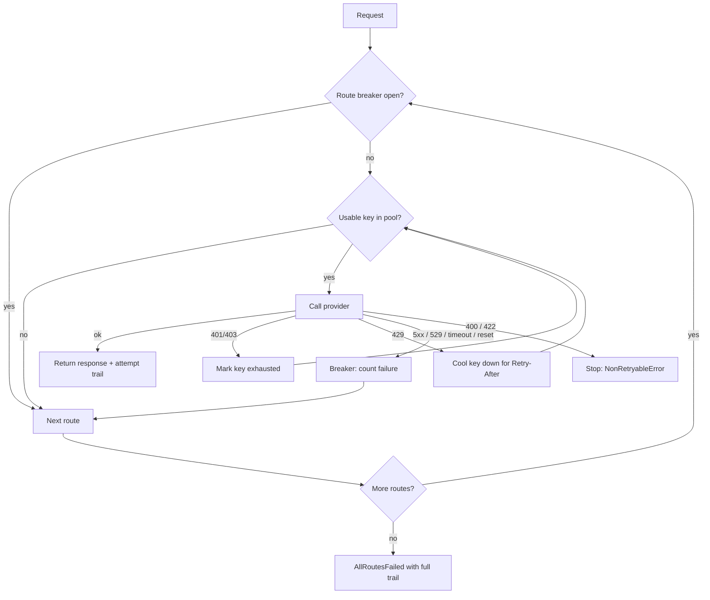

# llm-provider-resilience

[](https://github.com/s0yabean/llm-provider-resilience/actions/workflows/ci.yml)

A small, dependency-free Python module and a set of runbooks for keeping LLM-backed agents working through rate limits, provider outages, expired keys and gateway faults.

## The problem

An agent that runs unattended (scheduled jobs, background workers, a chat bot) depends on a model provider for every step. When that provider fails, the agent usually fails in a way nobody sees:

- **Expired credentials.** OAuth tokens from a CLI login expire, and a headless server cannot refresh them. Every job that shares the token gets a 401 at once.
- **Rate limits.** One busy key returns 429 while other keys, or other providers, have capacity.
- **Provider outages.** 503, 529, timeouts and broken pipes. Without a breaker, every request waits out the full timeout on the dead provider before trying anything else.
- **Silent workers.** A worker whose first model call fails exits with code 0 without reporting, and its task sits in `running` for hours. Fallback instructions written into the task never get read, because reading them needs a working model.
- **Gateway faults.** A chat gateway that is connected but answers nobody, or stops after a reboot, looks like a model problem and is not.

These patterns come from running a multi-agent system day to day, where each of them broke something before it was fixed.

## Approach

Classify each failure first, then act on the class. Credential failures rotate keys within a provider. Provider failures move to the next provider and count toward a circuit breaker. Bad requests stop, because no other provider will fix them. Tool errors are never treated as provider errors.



Pieces:

| Module | What it does |
|---|---|
| `errors.py` | Maps HTTP status codes and network exceptions to one of eight failure kinds |
| `credentials.py` | `CredentialPool`: several keys per provider, fill-first or round-robin, per-key health (exhausted on 401, cooling on 429), never prints a secret |
| `breaker.py` | `CircuitBreaker`: closed / open / half-open per provider, so an outage costs a few calls, not one per request |
| `chain.py` | `FallbackChain`: ordered routes, decision table above, full attempt trail on every result, and `preflight()` to probe routes before dispatching unattended work |
| `worker.py` | `run_task`: guarantees an unattended worker reports exactly one of complete or block |

Providers are anything with a `complete(model, request, secret)` method, so the chain works with any SDK or HTTP client. `examples/http_adapter.py` wraps an OpenAI-compatible endpoint with the standard library.

## Results

This repo has no published production figures. What it does show, with no network and no keys:

- **21 unit tests** covering each failure kind, key rotation, cooldown expiry, breaker transitions, preflight, and the worker exit protocol.
- **A replayed bad day** (`examples/simulate_outage.py`, synthetic): the primary's first key has expired, its second key is rate-limited, then the primary returns 503s. All 12 requests are answered. The breaker opens after two 503s, so five requests skip the dead primary without calling it, and traffic returns to the primary on the first trial call after recovery.

## Quickstart

Python 3.9 or later. No dependencies, no API keys.

```bash
git clone https://github.com/s0yabean/llm-provider-resilience.git
cd llm-provider-resilience
python3 -m unittest discover -s tests -v
python3 examples/simulate_outage.py
```

Use it in your own code:

```python
from llm_resilience import CircuitBreaker, CredentialPool, FallbackChain, Route

chain = FallbackChain([
    Route(my_primary_adapter, "primary-model",
          CredentialPool.from_env("PRIMARY_API_KEY_1", "PRIMARY_API_KEY_2"),
          CircuitBreaker(failure_threshold=3, recovery_timeout=30)),
    Route(my_backup_adapter, "backup-model", CredentialPool.from_env("BACKUP_API_KEY_1")),
    Route(my_local_adapter, "local-model"),  # no key needed
])

result = chain.call("Summarise this ticket ...")
print(result.response, result.route, [a.outcome for a in result.attempts])
```

To try real endpoints, copy `.env.example` to `.env`, fill it in, export it, and run `python3 examples/http_adapter.py`. It sends one short probe per route.

## Repo layout

```
src/llm_resilience/   the module (errors, credentials, breaker, chain, worker, fakes)
tests/                unit tests using fake providers
examples/             outage simulation and an HTTP adapter sketch
runbooks/             step-by-step diagnosis for each failure mode
skills/               the same knowledge packaged as an agent skill (SKILL.md)
```

Runbooks:

1. `01-provider-failover.md`: what should trigger a switch, ordering the chain, the "list stored as string" config trap, testing failover
2. `02-expired-credentials.md`: OAuth vs permanent keys, why chat works while cron fails, resetting exhausted keys
3. `03-scheduled-jobs.md`: jobs that never ran because the model was unreachable; taking the model out of jobs that do not need it
4. `04-unattended-workers.md`: the zombie-task pattern, dispatch-time fallback, exit protocol, concurrency
5. `05-messaging-gateway-silent.md`: isolating a connected-but-silent chat bot in four segments
6. `06-gateway-persistence.md`: surviving reboots in containers; the supervisor `HOME` mismatch trap
7. `07-secrets-in-agent-shells.md`: keeping keys out of agent-visible text; passing keys to tool servers

## Design decisions

- **Classify, then act.** The same retry for a 401 and a 503 is wrong in both directions: rotating keys does not help an outage, and switching providers wastes a healthy provider when one key expired.
- **Credential failures do not trip the breaker.** A dead key says nothing about the provider. Outages do not mark keys exhausted, so keys are still usable when the provider recovers.
- **Bad requests do not fall back.** A request that is too long or malformed for one provider usually fails on the next, and falling back hides the bug.
- **Fallback at dispatch, not in the prompt.** `preflight()` and `run_task()` exist because instructions inside a task are unreachable when the first call fails.
- **Injectable clock, no sleeping.** Cooldowns and breaker timeouts are tested by advancing a fake clock, so the suite runs in milliseconds.
- **No dependencies.** It is meant to be read in one sitting and copied into a project if that is easier than installing it.

What I would do next:

- Thread safety for the pool and breaker (a lock, and a single trial call in half-open state under concurrency).
- An async variant of `FallbackChain.call`.
- Per-route latency budgets, so a slow but working provider can be demoted.
- Emit attempts as structured metrics (fallback rate per route, keys exhausted) for alerting.

## More

Written by Tony Tong. More of my work: https://tonytonggg.com

MIT licence.
